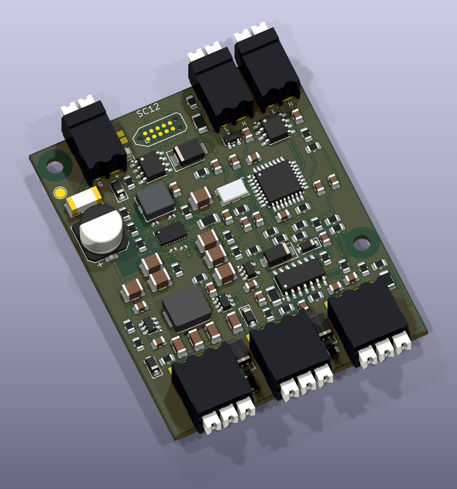
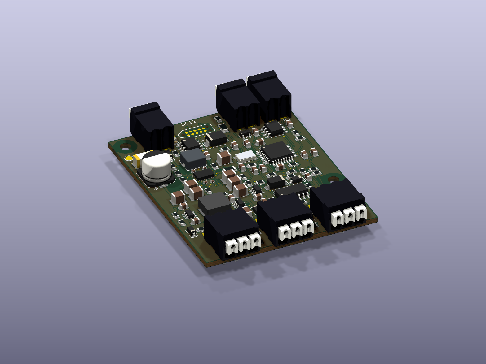

# FRC Sensor CAN

A compact interface for industrial photoelectric sensors and digital logic, with sensor power and a documented CAN protocol for FRC team projects.

**Rev D SC12 adds regulated 12 V sensor power:** three inputs, selectable 5 V / 12 V output, a 52 × 64 mm four-layer PCB, horizontal Weidmüller push terminals and compact programming contacts. A, B, B-2 and C remain available with their matching files.

**All revisions are unbuilt engineering prototypes.** The repository provides CAD, manufacturing files and computational checks. Physical power, thermal, sensor, CAN, EMC and assembly qualification remain pending; this is not a production-certified or FIRST-approved commercial product.

[Rev D guide](rev_d/README.md) · [DigiKey BOM](rev_d/bom/BOM_grouped.csv) · [Wiring](rev_d/docs/WIRING.md) · [Handbook](rev_d/output/documentation/SC12_RevD_Handbook.pdf) · [Prototype release](rev_d/release/FRC_Sensor_CAN_RevD_SC12_Prototype.zip) · [Factory packet](rev_d/order/RevD_SC12_Factory_Upload.zip)

Rev D targets **6–22 V input and 300 mA shared per output rail**. Its buck-boost converter maintains nominal 12 V above and below the battery's 12 V crossing. Firmware reports qualified rail-health indications and pauses counts during power faults; Java/C++ input helpers reject stale or faulted data. Verify the exact Omron/Banner sensor model—some NPN residual-voltage limits require special attention. See the [compatibility notes](rev_d/docs/WIRING.md).

The design has **104 fitted parts**, mostly 0805 or larger passives, with four local 0402 capacitors and a fine-pitch power QFN that requires stencil/reflow work. The dated DigiKey quantity-one component estimate is **$54.89**, $10.99 above Rev C. Board area is 14.3% above C and 18.4% below B/B-2. [Design choices and capacitor review](rev_d/docs/SIMPLIFICATION.md).

## Revision comparison

### Purpose and differences

| Revision | Made for | Main differences | Tradeoff |
|---|---|---|---|
| [A](REV_A.md) | Original four-input sensor-to-CAN prototype, with selectable sensor power and input thresholds. | Establishes the baseline: four inputs, Würth terminals and a 2.54 mm service header. | Largest board at 96 × 96 mm; battery-powered sensors can lose power during battery sag. |
| [B](rev_b/README.md) | A compact three-input design aimed at hand assembly and convenient wiring. | Compared with A: 55.7% less PCB area, horizontal push terminals, compact pogo programming contacts and a wider 5–22 V input target. Retains software rail control/monitoring and selectable thresholds. | One fewer input than A; higher dated parts cost; sensor battery output remains unregulated. |
| [B-2](rev_b2/README.md) | A version of B prepared for China factory assembly with lower parts cost. | Same B circuit, copper geometry, pinouts and equivalent firmware. Changes 49 passive placements to equivalent parts, sources eight unchanged MPNs at lower prices and adds factory BOM/CPL and quotation files. | No parts or functions removed; factory sourcing and assembly fees still need review. |
| [C Lite](rev_c/README.md) | A smaller, simpler three-input interface with fewer parts and no loose jumpers. | Compared with B/B-2: 144 → 89 fitted parts, 52 × 56 mm PCB, solder selectors, fixed input thresholds and hardware-only sensor power. Uses Lite protocol v2. | Minimum input rises to 6 V; loses software rail control and power-health reporting. Battery output still follows the supply. |
| [D SC12](rev_d/README.md) | A compact interface for compatible industrial sensors that need regulated 12 V through battery sag. | Compared with C: replaces the battery output with regulated 12 V, retains regulated 5 V, and adds rail-health reporting and fault-aware counting/drivers with protocol v3. Uses 104 fitted parts and a 52 × 64 mm four-layer PCB. | Larger and more expensive than C; the power QFN and four 0402 capacitors make assembly more demanding. |

The [earlier Rev B connector iteration](rev_b/history/before_horizontal_connectors/README.md) used angled /135 terminals. It is retained for traceability; the current B and B-2 designs use horizontal /90 terminals.

### Specifications at a glance

| Revision | PCB | Inputs | Input target | Sensor supplies | Dated parts estimate |
|---|---|---|---|---|---|
| [A](REV_A.md) | 96 × 96 mm | 4 | 6–18 V | 5 V + protected battery | $49.61 |
| [B](rev_b/README.md) | 60 × 68 mm | 3 | 5–22 V | 5 V + protected battery | $59.30 |
| [B-2](rev_b2/README.md) | 60 × 68 mm | 3 | 5–22 V | 5 V + protected battery | $46.35 |
| [C Lite](rev_c/README.md) | 52 × 56 mm | 3 | 6–22 V | 5 V + protected battery | $43.90 |
| [D SC12](rev_d/README.md) | 52 × 64 mm | 3 | 6–22 V | Regulated 5 V + regulated 12 V | $54.89 |

Prices are dated component estimates, not delivered PCBA quotations. PCB, stencil, assembly, attrition, shipping and taxes are extra. B-2 has a separate [China assembly cost model](rev_b2/docs/COST.md). No factory order has been placed.

| Rev A | Rev B | Rev B-2 | Rev C Lite |
|---|---|---|---|
|  |  |  |  |
| [BOM](bom/README.md) | [BOM](rev_b/bom/BOM_grouped.csv) | [Factory BOM](rev_b2/bom/BOM_turnkey.csv) | [BOM](rev_c/bom/BOM_grouped.csv) |
| [Release](release/FRC_Sensor_CAN_RevA_Prototype.zip) | [Release](rev_b/release/FRC_Sensor_CAN_RevB_Prototype.zip) | [Release](rev_b2/release/FRC_Sensor_CAN_RevB2_Prototype.zip) | [Release](rev_c/release/FRC_Sensor_CAN_RevC_Lite_Prototype.zip) |

Use each revision's PCB, BOM, firmware and wiring guide together. Root design directories belong to **Rev A**; the other revisions are self-contained in `rev_b/`, `rev_b2/`, `rev_c/` and `rev_d/`. Rev C protocol v2 and Rev D protocol v3 share API numbers but have different payload validation and hardware identities. They are not interchangeable.

## Horizontal push connectors and mechanical files

B/B-2/C/D use **Weidmüller 1824420000**, LSF-SMT 3.50/02/90 3.5SN BK TU, and **1824430000**, LSF-SMT 3.50/03/90 3.5SN BK TU. `/90` gives horizontal wire entry parallel to the PCB. These exact parts are THT/THR despite “SMT” in the family name; each pole has two solder legs.

The renders use official manufacturer STEP geometry, aligned with the footprint pins, with project display colors. [Connector provenance](rev_d/docs/CONNECTORS.md). Rev D's conservative connector envelope is **52 × 72.1 mm**, plus wire bends, strain relief and button access. [STEP](rev_d/output/mechanical/FRC_Sensor_CAN.step) and [dimensioned drawing](rev_d/output/mechanical/mechanical_drawing.pdf) provide the nominal handoff for a later enclosure design; physical fit is untested.

## Operation and verification

Inputs target positive 0–30 V signals with a common ground. A/B/B-2 have selectable logic and industrial thresholds; C/D use fixed LOW ≤1.2 V / HIGH ≥2.4 V targets under documented tolerance/leakage budgets. Suitable 12 V PNP/NPN sensors and 3.3/5 V logic are supported; 1.8 V, analog, IO-Link and safety/OSSD compatibility are not promised.

A/B/B-2/C battery outputs follow the input and can brown out industrial sensors during battery sag. **D replaces that battery output with regulated 12 V.** The board uses STM32F042 plus an external TCAN3413 transceiver and an original Team Use protocol; it is not a CTRE Phoenix/Tuner device.

[Rev D qualification plan](rev_d/docs/VALIDATION.md) distinguishes native ERC/DRC, manufacturing geometry, numerical budgets and software tests from the pending physical tests and FRC integration requirements. [Revision history](REVISIONS.md), [tools](TOOLS.md), and [repository policy](CONTRIBUTING.md) explain the preserved designs and generated deliverables.

No blanket license has been selected for original project work. Third-party notices and manufacturer source provenance remain in each revision's `licenses/` and source documentation.
