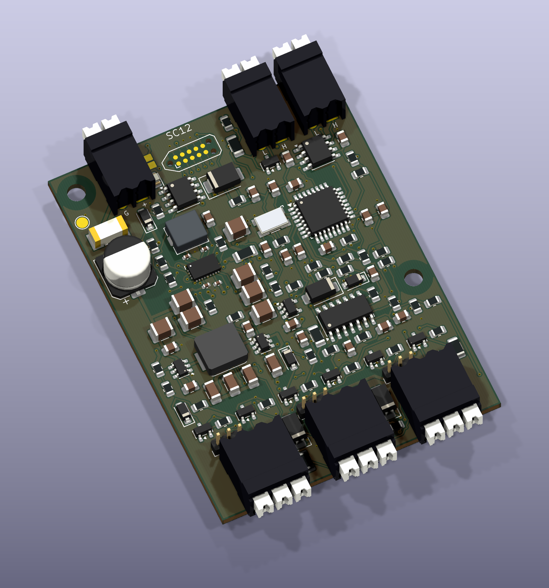
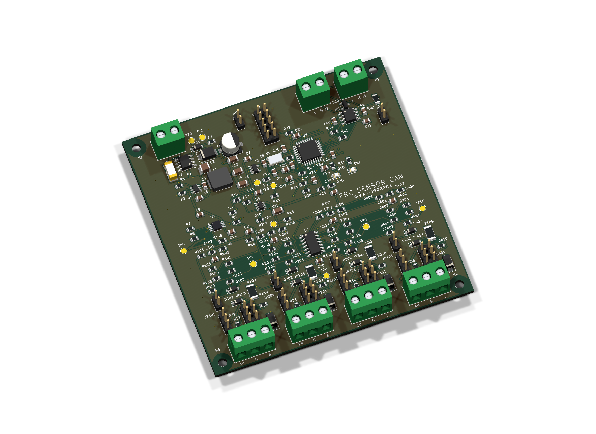
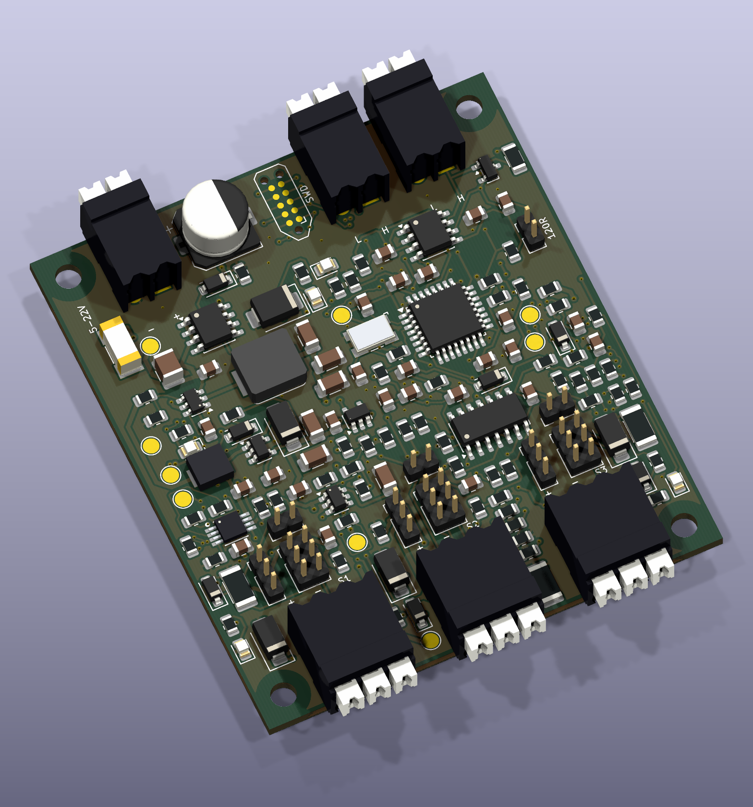

# FRC Sensor CAN

A compact interface for industrial photoelectric sensors and digital logic, with sensor power and a documented CAN protocol for FRC team projects.

**Rev E adds software-selectable NPN, PNP and push-pull inputs**, plus floating detection and keeper modes. Each of the three channels is configured independently over CAN; no input-bias jumper or solder selector is needed. The separate removable caps still choose regulated 5 V or 12 V sensor power. [Rev E guide](rev_e/README.md) · [Input modes](rev_e/docs/INPUT_MODES.md).

Rev E targets 6–22 V board input, positive 0–30 V digital signals and 300 mA shared per sensor rail. Its 52 × 70 mm four-layer PCB keeps every component on top: 111 factory SMT parts and nine user-soldered through-hole parts. Parts purchasing at ten boards is approximately **$35.14 each**, before PCB, assembly, freight and tax. [Cost basis](rev_e/docs/COST_REDUCTION.md).

CAN setup includes full-UID discovery, ID and persistent per-input settings, a desktop window, robot drivers and recoverable firmware uploads after initial SWD installation. Rev E uses hardware identity 5 / protocol 4 / firmware 0.6.0. This is an independent sensor-to-CAN design; it is not compatible with CTRE Phoenix or GrappleHook.

**All revisions are unbuilt engineering prototypes.** Native CAD, manufacturing files and computational checks are provided; physical power, sensor, thermal, CAN, EMC and vibration qualification remain pending. Floating detection cannot distinguish a broken cable from a normally inactive open-collector output.

[Factory packet](rev_e/order/RevE_SC12_Factory_Upload.zip) · [SMT BOM](rev_e/bom/Factory_BOM.csv) · [Hand-solder parts](rev_e/bom/Hand_solder_BOM.csv) · [Wiring](rev_e/docs/WIRING.md) · [Handbook](rev_e/output/documentation/SC12_RevE_Handbook.pdf) · [Source/review release](rev_e/release/FRC_Sensor_CAN_RevE_SC12_Prototype.zip)

## Revision comparison

### Purpose and differences

| Revision | Made for | Main differences | Tradeoff |
|---|---|---|---|
| [A](REV_A.md) | Original four-input sensor-to-CAN prototype, with selectable sensor power and input thresholds. | Establishes the baseline: four inputs, Würth terminals and a 2.54 mm service header. | Largest board at 96 × 96 mm; battery-powered sensors can lose power during battery sag. |
| [B](rev_b/README.md) | A compact three-input design aimed at hand assembly and convenient wiring. | Compared with A: 55.7% less PCB area, horizontal push terminals, compact pogo programming contacts and a wider 5–22 V input target. Retains software rail control/monitoring and selectable thresholds. | One fewer input than A; higher dated parts cost; sensor battery output remains unregulated. |
| [B-2](rev_b2/README.md) | A version of B prepared for China factory assembly with lower parts cost. | Same B circuit, copper geometry, pinouts and equivalent firmware. Changes 49 passive placements to equivalent parts, sources eight unchanged MPNs at lower prices and adds factory BOM/CPL and quotation files. | No parts or functions removed; factory sourcing and assembly fees still need review. |
| [C Lite](rev_c/README.md) | A smaller, simpler three-input interface with fewer parts and no loose jumpers. | Compared with B/B-2: 144 → 89 fitted parts, 52 × 56 mm PCB, solder selectors, fixed input thresholds and hardware-only sensor power. Uses Lite protocol v2. | Minimum input rises to 6 V; loses software rail control and power-health reporting. Battery output still follows the supply. |
| [D SC12](rev_d/README.md) | A compact interface for compatible industrial sensors that need regulated 12 V through battery sag. | Compared with C: replaces the battery output with regulated 12 V, retains regulated 5 V, and adds rail-health reporting and fault-aware counting/drivers with protocol v3. Uses 104 fitted parts and a 52 × 64 mm four-layer PCB. | Larger and more expensive than C; the power QFN and four 0402 capacitors make assembly more demanding. |
| [D-2 SC12](rev_d2/README.md) | Lower-cost China SMT assembly with user-fitted connectors and removable voltage selection. | Same D circuit and hardware-4/protocol-v3 telemetry; new 0.5.0 CAN setup/update firmware; 27 equivalent passive substitutions, lower-cost sourcing, three 2 mm power headers, split SMT/hand-solder BOM and CPL. 107 fitted parts plus three caps, all on top. | Four layers and the same power-stage complexity; caps require retention qualification. Batch parts savings do not establish a delivered PCBA price. |
| [E SC12](rev_e/README.md) | Independent software input configuration with CANdi-like mode choices. | Compared with D2: removes bias solder selectors, adds six MOSFETs/seven resistors, NPN/PNP/push-pull/float/keeper modes, active-state choices and protocol-v4 drivers/setup. Retains 5/12 V power caps and top-side assembly. | 52 × 70 mm, 120 fitted parts; about $0.45 more parts per board at ten units. Float mode is for slow signals and needs cable/sensor qualification. |

The [earlier Rev B connector iteration](rev_b/history/before_horizontal_connectors/README.md) used angled /135 terminals. It is retained for traceability; the current B and B-2 designs use horizontal /90 terminals.

### Specifications at a glance

| Revision | PCB | Inputs | Input target | Sensor supplies | Dated parts estimate |
|---|---|---|---|---|---|
| [A](REV_A.md) | 96 × 96 mm | 4 | 6–18 V | 5 V + protected battery | $49.61 |
| [B](rev_b/README.md) | 60 × 68 mm | 3 | 5–22 V | 5 V + protected battery | $59.30 |
| [B-2](rev_b2/README.md) | 60 × 68 mm | 3 | 5–22 V | 5 V + protected battery | $46.35 |
| [C Lite](rev_c/README.md) | 52 × 56 mm | 3 | 6–22 V | 5 V + protected battery | $43.90 |
| [D SC12](rev_d/README.md) | 52 × 64 mm | 3 | 6–22 V | Regulated 5 V + regulated 12 V | $54.89 |
| [D-2 SC12](rev_d2/README.md) | 52 × 64 mm | 3 | 6–22 V | Regulated 5 V + regulated 12 V | $44.16 consumed at first tiers; $34.69 purchased at 10 boards |
| [E SC12](rev_e/README.md) | 52 × 70 mm | 3 | 6–22 V | Regulated 5 V + regulated 12 V | $44.69 consumed at first tiers; $35.14 purchased at 10 boards |

D-2’s one-board procurement cash is $55.27 after supplier minimums; its ten-board figure includes purchase rounding. These bases differ from the earlier consumed-parts estimates. Prices are dated component estimates, not delivered PCBA quotations. PCB, stencil, assembly, attrition, shipping and taxes are extra. B-2 has a separate [China assembly cost model](rev_b2/docs/COST.md). No factory order has been placed.

| Rev A | Rev B | Rev B-2 | Rev C Lite |
|---|---|---|---|
|  |  |  |  |
| [BOM](bom/README.md) | [BOM](rev_b/bom/BOM_grouped.csv) | [Factory BOM](rev_b2/bom/BOM_turnkey.csv) | [BOM](rev_c/bom/BOM_grouped.csv) |
| [Release](release/FRC_Sensor_CAN_RevA_Prototype.zip) | [Release](rev_b/release/FRC_Sensor_CAN_RevB_Prototype.zip) | [Release](rev_b2/release/FRC_Sensor_CAN_RevB2_Prototype.zip) | [Release](rev_c/release/FRC_Sensor_CAN_RevC_Lite_Prototype.zip) |

Use each revision's PCB, BOM, firmware and wiring guide together. Root design directories belong to **Rev A**; the other revisions are self-contained in `rev_b/`, `rev_b2/`, `rev_c/`, `rev_d/`, `rev_d2/` and `rev_e/`. D retains firmware 0.4.0; D-2 now uses 0.5.0 with a CAN bootloader and setup tool. Both retain hardware identity 4 and protocol-v3 telemetry. Rev C protocol v2 and D/D-2 protocol v3 share API numbers but have different payload validation and hardware identities; C firmware/drivers are not interchangeable with D/D-2.

## Horizontal push connectors and mechanical files

B/B-2/C/D/D-2 use **Weidmüller 1824420000**, LSF-SMT 3.50/02/90 3.5SN BK TU, and **1824430000**, LSF-SMT 3.50/03/90 3.5SN BK TU. `/90` gives horizontal wire entry parallel to the PCB. These exact parts are THT/THR despite “SMT” in the family name; each pole has two solder legs.

The renders use official manufacturer STEP geometry, aligned with the footprint pins, with project display colors. [Connector provenance](rev_d2/docs/CONNECTORS.md). D/D-2's conservative terminal envelope is **52 × 72.1 mm**, plus wire bends, strain relief and button access. The D-2 [STEP](rev_d2/output/mechanical/FRC_Sensor_CAN.step) and [dimensioned drawing](rev_d2/output/mechanical/mechanical_drawing.pdf) include its voltage headers; allow access to remove their caps. Physical fit is untested.

## Operation and verification

**CAN setup and updates implemented in D-2:** [instructions](rev_d2/docs/CAN_SERVICE.md) cover full-UID discovery, blink, persistent CAN-ID/settings and recoverable firmware uploads through laptop CLI/GUI and robot bridges. Initial installation uses SWD. Software simulations and 2026/2027 bridge compilation pass; real-board/controller qualification remains pending. [Completed work and next qualification loop](rev_d2/docs/OPTIMIZATION_PLAN.md).

Inputs target positive 0–30 V signals with a common ground. A/B/B-2 have selectable logic and industrial thresholds; C/D/D-2 use fixed LOW ≤1.2 V / HIGH ≥2.4 V targets under documented tolerance/leakage budgets. Suitable 12 V PNP/NPN sensors and 3.3/5 V logic are supported; 1.8 V, analog, IO-Link and safety/OSSD compatibility are not promised.

A/B/B-2/C battery outputs follow the input and can brown out industrial sensors during battery sag. **D replaces that battery output with regulated 12 V.** The board uses STM32F042 plus an external TCAN3413 transceiver and an original Team Use protocol; it is not a CTRE Phoenix/Tuner device.

[Rev D-2 qualification plan](rev_d2/docs/VALIDATION.md) distinguishes native ERC/DRC, manufacturing geometry, numerical budgets and software tests from the pending physical tests and FRC integration requirements. [Revision history](REVISIONS.md), [D-2 tools](rev_d2/TOOLS.md), and [repository policy](CONTRIBUTING.md) explain the preserved designs and generated deliverables.

No blanket license has been selected for original project work. Third-party notices and manufacturer source provenance remain in each revision's `licenses/` and source documentation.
