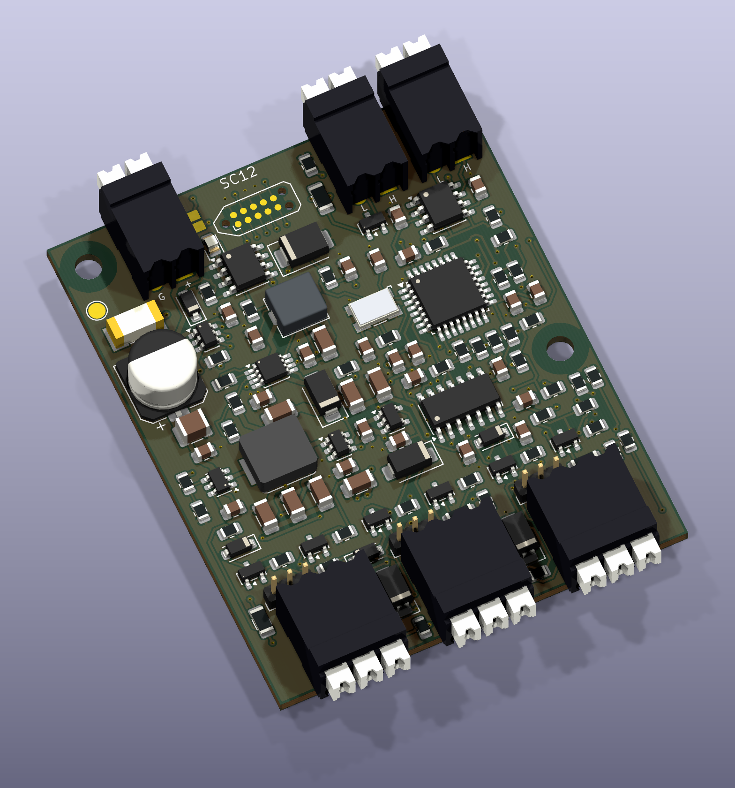

# sugarCANe / SC12 Rev H — current design

[Repository: barkinvar/sugerCANe](https://github.com/barkinvar/sugerCANe) · [Folder map](../README.md#folder-map)

Three digital sensor inputs over CAN, with regulated **5 V / 12 V sensor power** and software-selectable **NPN, PNP, push-pull, floating detection and keeper**. Removable 2 mm jumpers select each port's power voltage. All components mount on the top.

The bold pixel **sugarCANe** wordmark and original pixel-cane illustration on a raised island with a stepped underside fill the underside; it carries no other text. Connector and voltage labels remain on top, with the full programming map in the wiring guide. [Bottom render](output/review/board_bottom.png) · [Vector artwork and lettering source](hardware/artwork/README.md).

Rev H adds one enclosure-facing RGB status LED and a hand-soldered recessed female programming socket for a ten-board batch. The LED is on the right, above the mounting hole, with a 6 mm circular area reserved for a printed light duct; see the [enclosure dimensions](docs/STATUS_AND_PROGRAMMING.md#enclosure-location). It retains Rev G's power protection and physical voltage jumpers. The 12 V reservoir is upstream of a controlled output eFuse; both rails have default-off enables and CAN fault reset. Two ADC channels measure the protected rails. [Engineering review](docs/ORDER_READINESS.md) · [verification and bench procedure](docs/VALIDATION.md). This design uses its own CAN protocol; it is not CTRE Phoenix or GrappleHook compatible.

**Rev H status:** JLC sourcing candidate with all 55 SMT types matched; public stock covers 54 for ten boards. U5 needs exact-part sourcing. Native CAD checks pass; new simulations are deferred until user approval. Existing power/input reports are baseline evidence, with full coupled startup already incomplete. [Review the substitutions](docs/JLC_SOURCING.md) · [check summary](reports/release_checks.json).

| Specification | Rev H |
|---|---|
| Board supply | 6–22 V DC |
| Sensor supplies | Regulated 5 V / 12 V; **300 mA shared per rail**, not per port |
| Signal targets | Positive 0–30 V; LOW ≤1.2 V, HIGH ≥2.4 V; common ground |
| Input setup | Software bias and active-state selection independently per channel |
| Protection | Reverse input, fuse/TVS, separate protected 5 V and 12 V outputs, controlled 12 V inrush |
| Fault reset | Remove the fault, then use CAN power reset; hardware limits remain independent |
| Controller | STM32F042K6T6, TCAN3413; 1 Mbit/s classic CAN |
| Software | App 0.9.0, bootloader 1.1.0, hardware 8, protocol 4 |
| Servicing | CAN discovery, ID/settings and recoverable firmware upload; initial installation through a 2.54 mm SWD service socket |
| PCB / assembly | **52 × 74 mm**, four copper layers, 130 top SMT parts + ten hand-soldered parts + three loose caps |

Parts purchasing is about **$25.61 per board at ten boards before SMT attrition**, or **$26.48** including a conservative allowance. These include the hand-fitted parts and three loose caps, plus a provisional price for the unavailable MCU. PCB, assembly, freight and tax are extra. [Cost calculation](docs/COST_REDUCTION.md).

| What you want to do | Start here |
|---|---|
| Wire and configure a sensor | [Wiring](docs/WIRING.md), [input modes](docs/INPUT_MODES.md) |
| Understand the circuit | [Power and input design](DESIGN_PLAN.md), [schematic PDF](output/assembly/schematic.pdf) |
| Request a prototype quotation | [Factory instructions](docs/FACTORY_ORDER.md), [package status](order/README.md) |
| Read LED / choose a programmer | [Status and programming](docs/STATUS_AND_PROGRAMMING.md) |
| Assemble and program | [Assembly](docs/ASSEMBLY.md), [unit fixture](docs/FIXTURE.md), [CAN service](docs/CAN_SERVICE.md) |
| Write robot code | [Examples/drivers](examples/README.md), [CAN protocol](docs/CAN_PROTOCOL.md) |
| Edit the board | [KiCad project](hardware/FRC_Sensor_CAN.kicad_pro), [PCB](hardware/FRC_Sensor_CAN.kicad_pcb), [interactive BOM](output/assembly/interactive_bom.html) |
| Design an enclosure | [STEP](output/mechanical/FRC_Sensor_CAN.step), [mechanical drawing](output/mechanical/mechanical_drawing.pdf) |
| Review or reproduce checks | [Validation](docs/VALIDATION.md), [power simulations](reports/electrical/boost_spice.json), [check summary](reports/release_checks.json), [tool setup](TOOLS.md) |
| Download everything | [Source/release status](release/README.md), [handbook](output/documentation/SC12_RevH_Handbook.pdf) |

Change voltage jumpers only with power disconnected. A missing cap disconnects port power, not its signal wire. Input mode changes use CAN software. Rail voltage readback uses the MCU ADC and factory voltage-reference calibration. External signal inputs remain digital; rail measurement does not add user analog-input or encoder support.

The current layout has rounded corners, aligned input-bias transistors, a recessed female debug socket, improved edge clearances and visible voltage-selector/input labels. Routing uses straight horizontal/vertical/45° centerlines, with 1,993 segments instead of 4,113. The [enforced routing rules](docs/ROUTING_RULES.md) reject curves, duplicates, overlaps and tiny free jogs. Component positions, all 245 vias and artwork are unchanged. It remains 52 × 74 mm with top-side assembly. See [all four copper layers](output/assembly/gerber_copper_review.pdf) and [connector details](docs/CONNECTORS.md).
