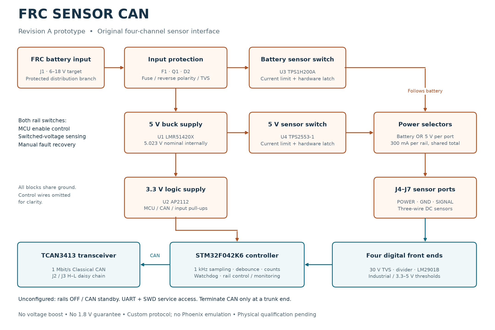

**Revision A architecture — frozen prototype direction, 2026-09-07**

**Scope: Rev A.** [Revision overview](https://github.com/barkinvar/candi-clone/blob/main/REV_A.md) · [All revisions](https://github.com/barkinvar/candi-clone/blob/main/REVISIONS.md).

The design favors inspectable solder joints, explicit sensor-mode selection, and fault containment. It uses four independent digital front ends and two shared, separately switched sensor-power rails. A two-layer 96 mm square board leaves room for an iron, tweezers, test probes, screw terminals and mounting holes.

A [vector PDF of this block diagram](../output/documentation/architecture.pdf) is included for printing and sharing.

The functional reference was CTRE CANdi's sensor-to-CAN role and its simultaneous battery/5 V outputs. This is an original circuit and protocol. The reference product also supports capabilities outside this revision, including PWM and quadrature decoding. [CTRE CANdi](https://store.ctr-electronics.com/products/candi)

| Block | Exact selected part | Reason |
| --- | --- | --- |
| MCU | STM32F042K6T6 | CAN controller; LQFP32 with 0.8 mm pitch; enough flash, RAM and GPIO |
| CAN PHY | TCAN3413DR | 3.3 V, SOIC8, standby default, dominant timeout and bus-fault protection |
| Input protection | 045101.5MRL, AO4485, MMSZ12T1G, SMBJ18A-E3/52 | Fuse, low-loss reverse-polarity MOSFET, gate clamp and transient suppression |
| Buck regulator | LMR51420XDDCR | Stocked 500 kHz PFM synchronous regulator; 36 V capability; six exposed leads |
| 3.3 V regulator | AP2112K-3.3TRG1 | Common SOT25 regulator; logic powered ahead of sensor switches |
| 5 V sensor switch | TPS2553DBVR-1 | Adjustable current limit and hardware latch-off |
| Battery sensor switch | TPS1H200AQDGNRQ1 | Adjustable current limit, configurable hardware latch delay, digital fault output |
| Input comparator | LM2901BIDR | Four ground-sensing comparators in SOIC14, powered from protected battery |
| Signal protection | SMAJ30A, BAT46W-E3-18 | Positive signal transient clamp; 100 V reverse-blocking bias diodes |
| Terminals | Wurth 691137710002 / 691137710003 | Exact 5.00 mm pitch; screw connection; through-hole assembly |

An ESP32-C3 would still require an external CAN transceiver: its TWAI peripheral is the protocol controller. The F042 avoids unused radio functions and is easier to inspect than a bare QFN. An ESP32 module is a possible different implementation, but changing the MCU would also require new layout, firmware and verification. [Espressif TWAI documentation](https://docs.espressif.com/projects/esp-idf/en/stable/esp32c3/api-reference/peripherals/twai.html)

**Power path**

J1 feeds the onboard fuse, then Q1 with its drain toward the input and source toward the protected rail. This orientation passes correctly polarized power through the body diode during startup; negative input polarity leaves the MOSFET off. D3 limits gate-source voltage and R3 pulls the gate toward ground. An enhanced MOSFET conducts in both directions, so this circuit is not a reverse-current blocker from externally powered outputs.

D2, C1, C2 and C3 suppress and decouple the protected input. U1/L1/C4/C5/C13 produce approximately 5.023 V internally. R1 is **101 kΩ, 0.1%, 25 ppm/°C** and R2 is **13.7 kΩ, 0.1%, 25 ppm/°C**. Three 22 µF output capacitors account for substantial DC-bias capacitance loss. U2 supplies the 3.3 V logic rail.

U3 supplies SENSOR_VBAT and U4 supplies SENSOR_5V. Their current limits sit above the intended 300 mA continuous load per rail. The limits are shared, so a short on one sensor disables the other sensors using that same rail. Neither rail is for motors, solenoids or other actuators. Large sensor startup capacitance can trip a rail even when steady current is acceptable.

C14 is 33 nF, setting approximately 11 ms nominal battery hardware latch delay. R23 senses the switched battery output, and the second ADC channel senses switched 5 V. Both update at 1 kHz. An enabled rail below a measured 4.5 V latches off after 5 ms startup blanking; ADC failure latches both. U3 also reports healthy loads below 10–20 mA as open load, so its digital FAULT alone is deliberately not used to disconnect battery sensors. Autonomous hardware current and thermal protection remain active. R4 is a 1 kΩ logic bleed and R14 a 10 kΩ battery-output bleed to control off-state leakage.

Hardware pulldowns keep both sensor enables low during reset. Factory firmware without valid configuration keeps sensor rails off and the CAN transceiver in standby. Configuration is stored only by an explicit service command. Overloads latch off; recovery requires an explicit command and at least 100 ms off time. A watchdog reset starts with both rails latched off. Low logic voltage, clock failure and a stalled foreground force a safe shutdown/reset.

**Input path**

Each SIGNAL terminal has a 30 V standoff TVS, two 110 kΩ series resistors, a 20 kΩ divider resistor, 910 kΩ positive feedback, a 1 nF C0G filter and a comparator output pulled to 3.3 V through 10 kΩ. The comparator reference uses 100 kΩ / 17.8 kΩ; closing the threshold jumper adds 7.15 kΩ in parallel with the lower resistor.

The independent bias selector offers a 4.7 kΩ pull-up to port power, a 4.7 kΩ pull-up to 3.3 V, or a 4.7 kΩ pulldown. Every branch has its own resistor. The pulldown is a 0.75 W 2010 part because it can see a continuous 30 V signal. Pull-up diodes prevent signal voltage from feeding back through the bias circuit.

Industrial NPN normally uses the port pull-up; PNP uses the pulldown. Driven 3.3/5 V push-pull signals use logic thresholds and no bias jumper. A 3.3 V open-drain signal uses the 3.3 V pull-up and logic thresholds. Software inversion is separate from these electrical choices.

**CAN and processing**

An 8 MHz crystal and ×6 PLL supply the 48 MHz clock. The MCU samples four comparator outputs at 1 kHz, applies 1–100 ms selectable debounce, and reports digital state every 10 ms. Rising-edge counts and diagnostic/identity packets use slower bounded rates. Baseline periodic traffic is 131 frames/s, conservatively about 2.1% of a 1 Mbit/s bus per board.

The hardware filter accepts this device's Team Use address and reserves a separate receive FIFO for FRC Broadcast Disable. Broadcast Disable turns both sensor rails off and latches them; it does not stop diagnostic communication. Normal robot disabled-state heartbeat handling is not used to switch sensor power. No actuator commands are generated.

The UART service interface and SWD header remain available for bring-up and repair. Pin1 is a 3.3 V reference output, not a board-power input. The connector is a custom 2×5, 2.54 mm header and is not the standard Cortex 10-pin cable pinout.

**Decisions changed during review**

The battery switch changed from TPS1H100A to the stocked TPS1H200A, requiring a new pin map and exposed-pad footprint. Separate bias resistors replaced a topology vulnerable to multiple-jumper shorts. The filter increased to 1 nF. A third buck capacitor covers DC-bias loss. Q1 replaced a series diode to recover low-battery voltage margin. The final 101 kΩ feedback resistor centers the 5 V output with allowance for sensor-switch and PCB trace loss.

These are engineering choices supported by the checked files. Physical qualification is still required; see [validation](VALIDATION.md) and [bring-up](BRING_UP.md).
