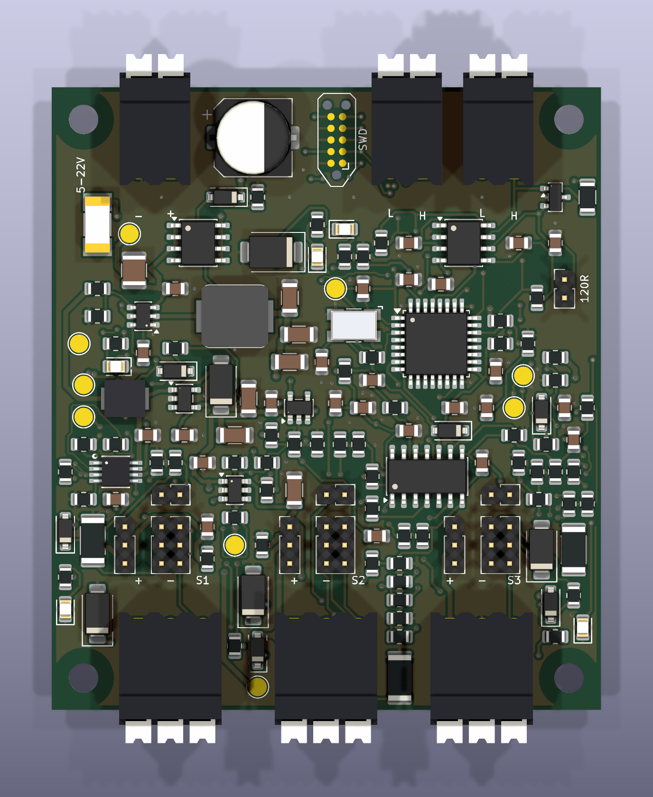
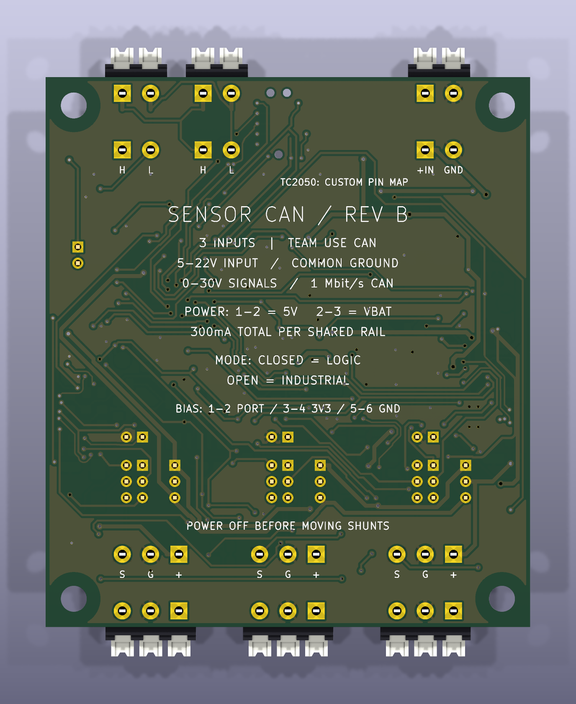

# FRC Sensor CAN — Rev B

**Scope: Rev B.** [Revision overview](https://github.com/barkinvar/candi-clone/blob/main/rev_b/README.md) · [All revisions](https://github.com/barkinvar/candi-clone/blob/main/REVISIONS.md).

**A compact three-sensor CAN interface with push-in wiring and selectable sensor power.** Rev B is a 60 × 68 mm, two-layer redesign, 55.7% smaller in area than the previous 96 × 96 mm board. It is an unbuilt prototype with computational checks and manufacturing files; hardware qualification remains pending.

| Feature | Rev B |
|---|---|
| Sensor channels | Three independent digital inputs |
| Board input target | 5–22 V DC at the connector, including tolerance and cable drop |
| Signal range | Positive 0–30 V, with selectable industrial or 3.3/5 V logic thresholds |
| Sensor power | Per-port physical selection: regulated nominal 5 V or switched VBAT |
| Software power control | Enable/disable and monitor each shared rail; voltage selection uses shunts |
| Current targets | 300 mA total on 5 V and 300 mA total on VBAT, shared across the ports |
| External connectors | Weidmuller 3.5 mm horizontal /90 push-in, through-hole |
| Programming | TC2050-IDC-NL footprint, 1.27 mm contact pitch, three guide holes; custom electrical adapter |
| Controller / CAN | STM32F042K6T6, separate TCAN3413, original 1 Mbit/s Team Use protocol |
| Assembly | Mostly 0805 or larger passives and leaded ICs; heatbed/reflow required for U3's exposed pad |
| Parts estimate | $59.30 at observed single-unit prices, including ten shunts; excludes PCB, tools and shipping |

VBAT follows the input; it is **not regulated 12 V**. Adding regulated 12 V or software voltage multiplexing would increase cost and complexity. Industrial sensors with a 10 V minimum can stop operating during battery sag even when this board remains powered. A nominal 24 V power supply is outside the board's input target. A separately powered sensor can still provide a positive signal up to 30 V with common ground and the correct configuration.

Logic-mode targets are LOW ≤0.8 V and HIGH ≥2.4 V; industrial-mode targets are LOW ≤4 V and HIGH ≥7 V. This is a digital interface; it does not promise 1.8 V logic, analog acquisition, IO-Link, quadrature or CTRE Phoenix/Tuner compatibility.

## Review and build files

- [KiCad project](hardware/FRC_Sensor_CAN.kicad_pro), [schematic](hardware/FRC_Sensor_CAN.kicad_sch), [routed PCB](hardware/FRC_Sensor_CAN.kicad_pcb)
- [Printable handbook](output/documentation/FRC_Sensor_CAN_RevB_Handbook.pdf), [BOM PDF](output/documentation/BOM_RevB.pdf)
- [Grouped BOM](bom/BOM_grouped.csv), [DigiKey import](bom/DigiKey_import.csv), [purchasing notes](docs/SOURCING.md)
- [Interactive assembly BOM](output/assembly/interactive_bom.html), [assembly drawing](output/assembly/top_assembly.pdf), [schematic PDF](output/assembly/schematic.pdf)
- [Gerbers and drills](output/fabrication/), [STEP assembly](output/mechanical/FRC_Sensor_CAN.step)
- [Wiring, shunts and pogo pin map](docs/WIRING.md), [hand assembly](docs/ASSEMBLY.md), [firmware](firmware/README.md), [robot examples](examples/README.md)
- [Validation evidence](docs/VALIDATION.md), [engineering decisions](docs/ENGINEERING.md), [bench worksheet](docs/QUALIFICATION.md), [design plan](DESIGN_PLAN.md)

Use Rev B hardware, BOM and firmware together. Rev A remains available in the repository root and its archived build package. Open the supplied native board as the authoritative routed design; placement/router scripts are engineering history, not a substitute for the saved board. Rebuilding the full routing from the initial placement is not part of release reproduction.

## Validation and limits

The final native ERC/DRC, model/schematic/PCB parity and independent exported-copper checks are recorded in the validation report. Firmware tests cover power faults, startup, watchdog handling, protocol behavior and the reserved fourth channel. Java, C++ and Python integration tests use simulated transports; actual CAN hardware and pogo programming have not been exercised.

Electrical calculations support the stated targets under their recorded assumptions. The 5 V output is nominal: the full-load routed-copper budget estimates roughly 4.75 V at the most distant port, before external cable loss. Boost startup simulations settle near 4.99 V, but do not validate the cascaded converters, real parasitics or temperature behavior. Complete the bench worksheet before treating any target as a qualified product rating.

See [TOOLS.md](TOOLS.md) for reproduction commands and [source notices](docs/SOURCES_AND_LICENSES.md) for provenance. No fabrication order or purchase has been made.

## Additional board views

Connector housings use official manufacturer STEP geometry; see [connector verification](docs/CONNECTORS.md). Render colors are illustrative.
