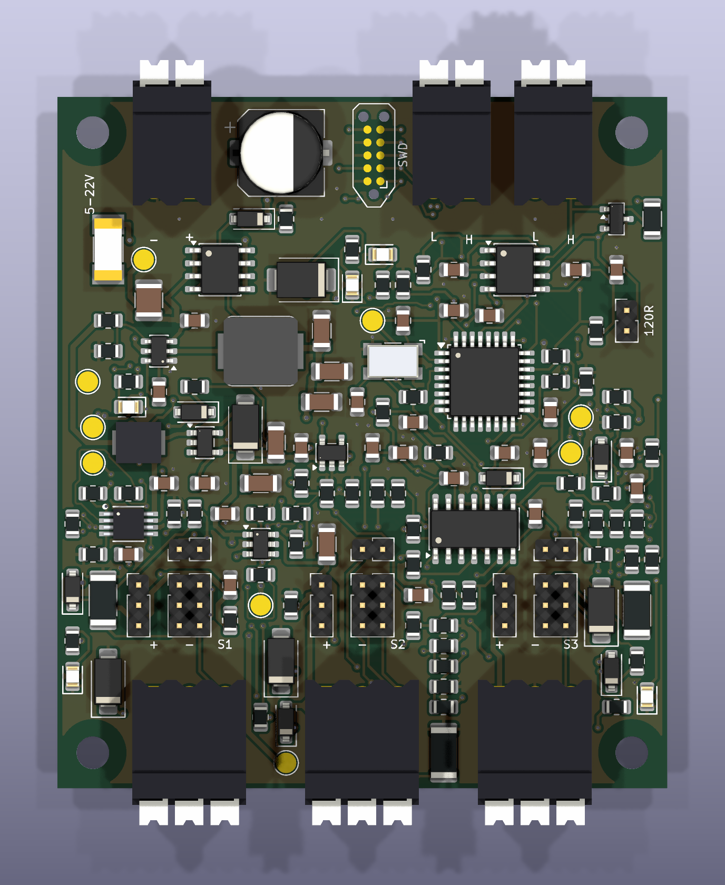
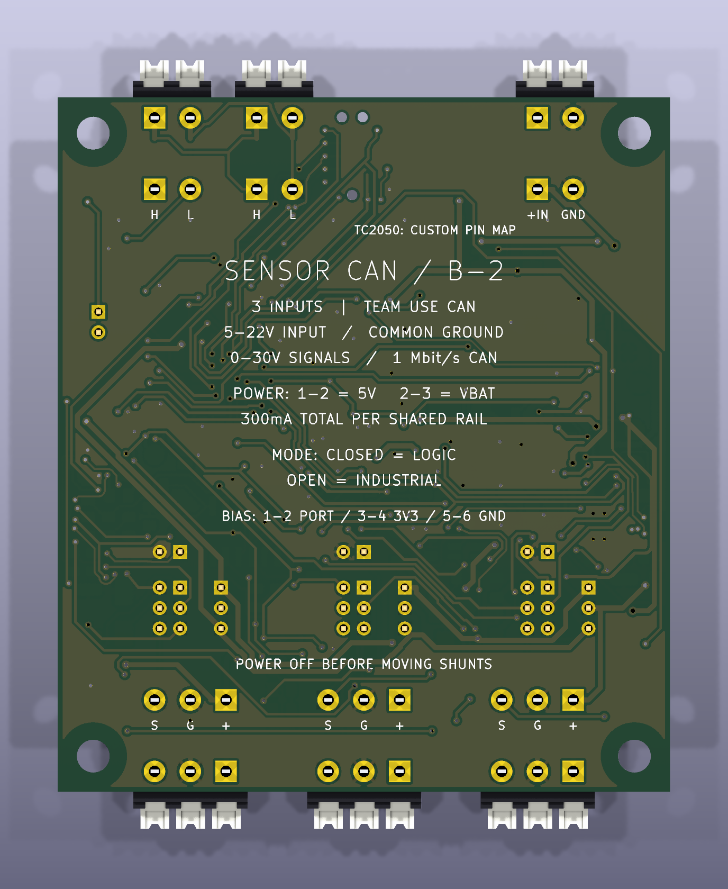

# FRC Sensor CAN — Rev B-2

**Scope: Rev B-2.** [Revision overview](https://github.com/barkinvar/candi-clone/blob/main/rev_b2/README.md) · [All revisions](https://github.com/barkinvar/candi-clone/blob/main/REVISIONS.md).

**China factory-assembly variant of the horizontal-connector Rev B.** Three sensor inputs, selectable regulated 5 V or battery sensor power, a 5–22 V board-input target and a 60 × 68 mm PCB. All 144 components mount on top. This is an unbuilt prototype with a complete quotation/build-data package; factory sourcing, panel engineering and placement review are still required.

The board uses horizontal **Weidmüller 1824420000** (power/CAN, two poles) and **1824430000** (sensors, three poles), LSF-SMT 3.50 **/90**. Reserve 60 × 76.1 mm for the assembly before cable space; the terminals are 8.5 mm high.

B-2 changes 37 resistors and 12 bypass capacitors to checked equivalents, and buys eight unchanged MPNs from cheaper observed sources. Nominal consumed component cost falls from $59.30 to **$46.35**, before MOQ, factory fees and shipping. No parts were deleted. The circuit, copper geometry, connector pinouts and firmware remain equivalent to Rev B.

## Order and cost

- [Factory upload packet](order/RevB2_Factory_Upload.zip)
- [Factory order instructions](docs/FACTORY_ORDER.md), [Gerber ZIP](order/RevB2_Gerbers.zip)
- [Complete turnkey BOM](bom/BOM_turnkey.csv), [JLCPCB matching BOM](bom/BOM_JLCPCB.csv), [factory CPL](output/assembly/CPL_JLCPCB.csv), [loose accessories](bom/ACCESSORIES.csv)
- [Estimated order costs](docs/COST.md), [cost spreadsheet](bom/cost_estimate.csv), [MOQ purchase quantities](bom/procurement_quantities.csv)
- [Exact part changes](docs/PART_CHANGES.md), [capacitor audit](docs/PASSIVE_REVIEW.md)

Budget roughly **$300–390 total for two assembled boards**, or **$435–535 for five**, including estimated shipping and excluding import taxes and optional factory programming. JLCPCB publishes a two-board minimum. These are engineering estimates, not a live quotation; the MCU and connectors require procurement review. This prototype is not yet a competitive retail-cost design.

## Engineering files

- [KiCad project](hardware/FRC_Sensor_CAN.kicad_pro), [schematic](hardware/FRC_Sensor_CAN.kicad_sch), [PCB](hardware/FRC_Sensor_CAN.kicad_pcb)
- [Assembly drawing](output/assembly/top_assembly.pdf), [schematic PDF](output/assembly/schematic.pdf), [interactive BOM](output/assembly/interactive_bom.html), [STEP](output/mechanical/FRC_Sensor_CAN.step)
- [Printable handbook](output/documentation/FRC_Sensor_CAN_RevB2_Handbook.pdf), [printable BOM](output/documentation/BOM_RevB2.pdf)
- [Wiring and configuration](docs/WIRING.md), [firmware/programming](firmware/README.md), [robot integration](examples/README.md), [validation](docs/VALIDATION.md), [qualification worksheet](docs/QUALIFICATION.md)

The input range is a design target measured at the board connector under load. VBAT follows the input and is not regulated 12 V. Shared sensor budgets are 300 mA on 5 V and 300 mA on VBAT, not per-port. A low battery can stop an industrial sensor with a 10 V minimum supply. Signal inputs accept positive 0–30 V through the protected divider with common ground; logic-mode targets are LOW ≤0.8 V / HIGH ≥2.4 V. The design does not promise 1.8 V logic or CTRE Phoenix/Tuner compatibility.

Native and exported-data checks are computational evidence. Actual thermal, surge, CAN, sensor and programmer tests remain pending. All shunts ship loose and all sensor-power selectors open. No physical board, purchase or factory upload has been made.

See [tools](TOOLS.md), [sources](docs/SOURCES_AND_LICENSES.md) and [factory requirements](docs/FACTORY_ORDER.md) before manufacturing.

## Additional board views

Connector housings use official manufacturer STEP geometry; see [connector verification](docs/CONNECTORS.md). Render colors are illustrative.
