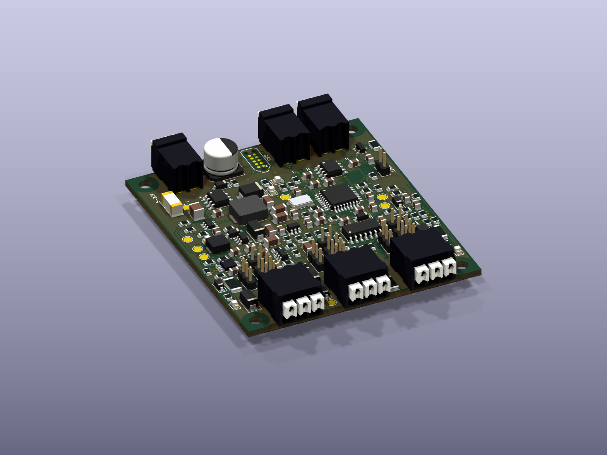

# Rev B-2 horizontal push-in connectors

**Scope: Rev B-2.** [Revision overview](https://github.com/barkinvar/candi-clone/blob/main/rev_b2/README.md) · [All revisions](https://github.com/barkinvar/candi-clone/blob/main/REVISIONS.md).

| Board references | Manufacturer order code | Full designation | DigiKey code |
|---|---|---|---|
| J1, J2, J3 | 1824420000 | LSF-SMT 3.50/02/90 3.5SN BK TU | 281-2020-ND |
| J4, J5, J6 | 1824430000 | LSF-SMT 3.50/03/90 3.5SN BK TU | 281-2021-ND |

Both are Weidmüller OMNIMATE LSF-SMT 3.50 push-in terminals with white push buttons and black housings. `/90` identifies horizontal wire entry parallel to the PCB. `/135` is angled and `/180` is vertical; those are not the current parts. The selected terminals have THT/THR solder legs, despite the series name containing “SMT”.

Manufacturer product pages and photographs: [2-pole 1824420000](https://eshop.weidmueller.com/en/lsf-smt-3-500290-3-5sn-bk-tu/p/1824420000), [3-pole 1824430000](https://eshop.weidmueller.com/en/lsf-smt-3-500390-3-5sn-bk-tu/p/1824430000). Local drawings: [2-pole datasheet](../sources/weidmuller_horizontal_1824420000.pdf), [3-pole datasheet](../sources/weidmuller_horizontal_1824430000.pdf).

## Why the earlier render looked wrong

The earlier project models were simple dimensional boxes with guessed button shapes. The purchasing codes and horizontal selection were correct, but those envelopes did not depict the real housing, buttons or wire openings accurately.

The current board renders and mechanical STEP now use **official manufacturer STEP geometry** downloaded through Weidmüller's public Support Center. Original files are retained unchanged under `hardware/library/3d/vendor/`. A rigid translation places rear pin one at the footprint origin and the seating plane on the PCB. Display colors are assigned by the project to match the black housing, white actuators and metallic pins. The geometry has not been redrawn or rescaled.

The checked STEP pair provides 3.5 mm pole pitch, 7 mm pin-row spacing, two legs per pole, 3.5 mm pin length and 8.5 mm height above the PCB. All ten unique modeled pin centers align with their footprint pads; the pin cross-section fits within the nominal 1.1 mm drill. This is a CAD check, not a measured production-part fit test. The existing native PCB, connector footprints and BOM codes are unchanged.

The vendor CAD's body has a small nominal offset from the generic drawing; its transformed geometry fits inside the existing footprint courtyard and the 14.75 mm reserved depth. Continue reserving **60 × 76.1 mm**, plus wires and actuator access, for the complete board assembly. Supplier CAD is nominal and is not a substitute for checking actual samples and tolerances.

## Reproduce and inspect

Run `python scripts/import_connector_models.py` in this revision directory with its Python environment activated. The script verifies the pin pattern, drill fit and vertical envelope before exporting the aligned models. [Provenance, hashes and pin coordinates](../hardware/library/3d/vendor_connectors.json) record the exact source files, public URLs and translation.

Regenerate the PCB renders and assembly STEP after importing the models. Manufacturer names and CAD remain third-party material; the project's original envelope models are no longer the geometry used for these horizontal terminals.
