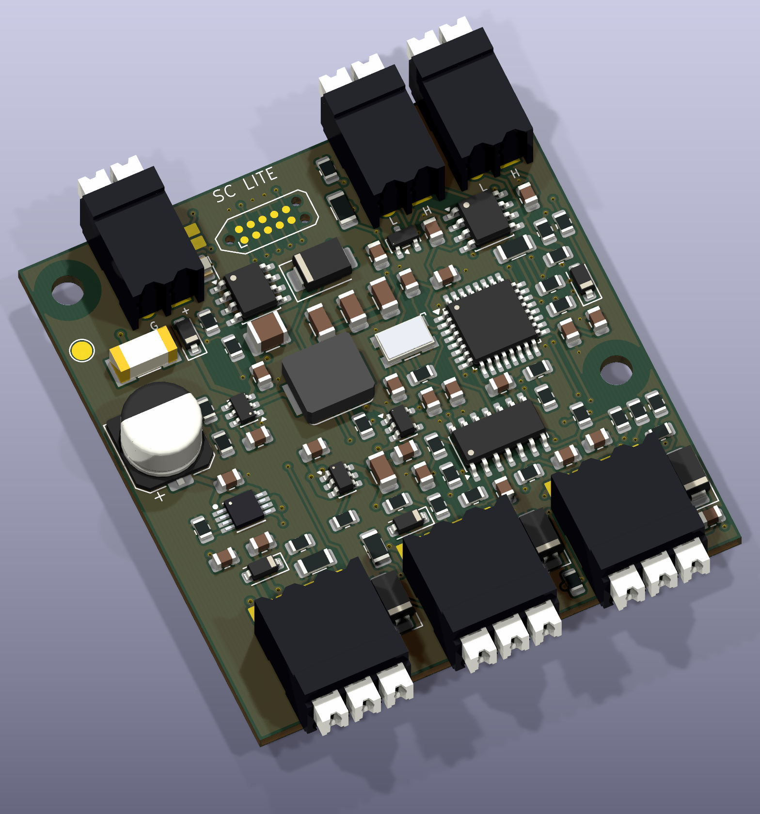
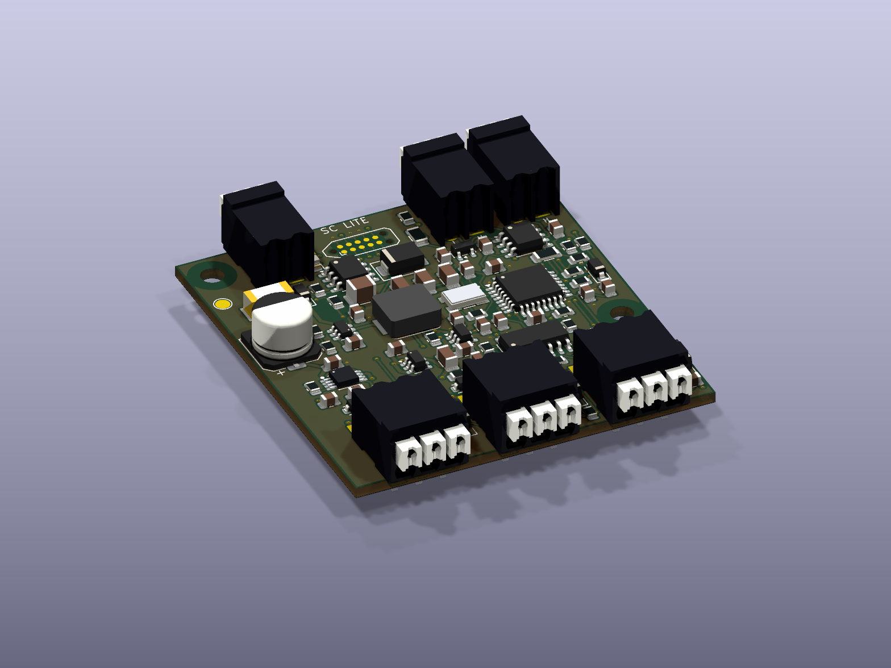

# SC Lite — Revision C

Three digital sensor inputs over CAN, with protected battery and regulated 5 V sensor power. **52 × 56 mm, 89 fitted parts, no plug-in jumpers.** This is the simplified successor to B/B-2; all are unbuilt prototypes.

| | Rev B | Rev C Lite |
|---|---|---|
| PCB | 60 × 68 mm | **52 × 56 mm; 28.6% less area** |
| Fitted parts | 144 | **89; 38.2% fewer** |
| Resistors / capacitors | 63 / 34 | **33 / 29** |
| Sensor inputs | 3 | 3 |
| Supply target | 5–22 V | **6–22 V** |
| Sensor power | Software control and monitoring | Hardware protected, always enabled |
| Configuration | 10 headers and loose shunts | 7 solder selectors, no purchased jumpers |
| Input threshold | Logic / industrial selectable | Fixed, 3.3/5 V and industrial NPN/PNP |
| Dated quantity-one parts estimate | $59.30 | **$43.90** |

Both designs use horizontal Weidmüller **1824420000** and **1824430000** push connectors. Rev C retains 0805 passives, a leaded LQFP MCU, SOIC comparator/transceiver and compact TC2050 programming pads. The battery current limiter still needs paste/heatbed for its exposed pad. Connector overhang gives a conservative **52 × 64.1 mm assembly envelope**, before wire/button clearance.

## Build and review

- [Complete prototype package](release/FRC_Sensor_CAN_RevC_Lite_Prototype.zip), [handbook](output/documentation/FRC_Sensor_CAN_RevC_Lite_Handbook.pdf).
- [Editable KiCad project](hardware/FRC_Sensor_CAN.kicad_pro), [schematic PDF](output/assembly/schematic.pdf), [interactive assembly BOM](output/assembly/interactive_bom.html).
- [DigiKey BOM](bom/BOM_grouped.csv), [DigiKey import](bom/DigiKey_import.csv), [factory instructions](docs/FACTORY_ORDER.md).
- [Wiring, solder settings and pogo map](docs/WIRING.md), [assembly](docs/ASSEMBLY.md), [firmware](firmware/README.md), [protocol](docs/CAN_PROTOCOL.md), [robot examples](examples/README.md).
- [What was removed and why](docs/SIMPLIFICATION.md), [calculations and qualification](docs/VALIDATION.md), [connector evidence](docs/CONNECTORS.md), [tools](TOOLS.md).

## Operating targets

Common-ground positive 0–30 V signals; LOW ≤1.2 V, HIGH ≥2.4 V at the input, under the documented component/leakage/temperature budgets. 1.8 V recognition is not promised. Each sensor chooses 5 V or protected input voltage with solder pads; **300 mA total per rail across all three ports**. Battery output follows the supply and cannot keep a 12 V sensor running through deep battery sag.

Removing the second converter means regulated 5 V requires at least 6 V input. Removing rail monitoring means CAN cannot distinguish a valid inactive sensor from a sensor that lost power. Sensor outputs are power supplies for sensors only, with no actuator control. Correct a short and cycle input power to reset a latched rail.

The standalone hardware checks, native ERC/DRC, independent exported-copper checks and firmware/driver tests are provided. **No physical board has been assembled or tested.** Startup, sensor loads, transients, EMC, thermal performance and FRC use require the [prototype qualification](docs/VALIDATION.md). This original Team Use protocol is not compatible with CTRE Phoenix/Tuner. Prices are dated observations, excluding PCB, assembly, attrition, freight and taxes.

[All revisions](https://github.com/barkinvar/candi-clone/blob/main/REVISIONS.md) · [Sources and notices](docs/SOURCES_AND_LICENSES.md)
