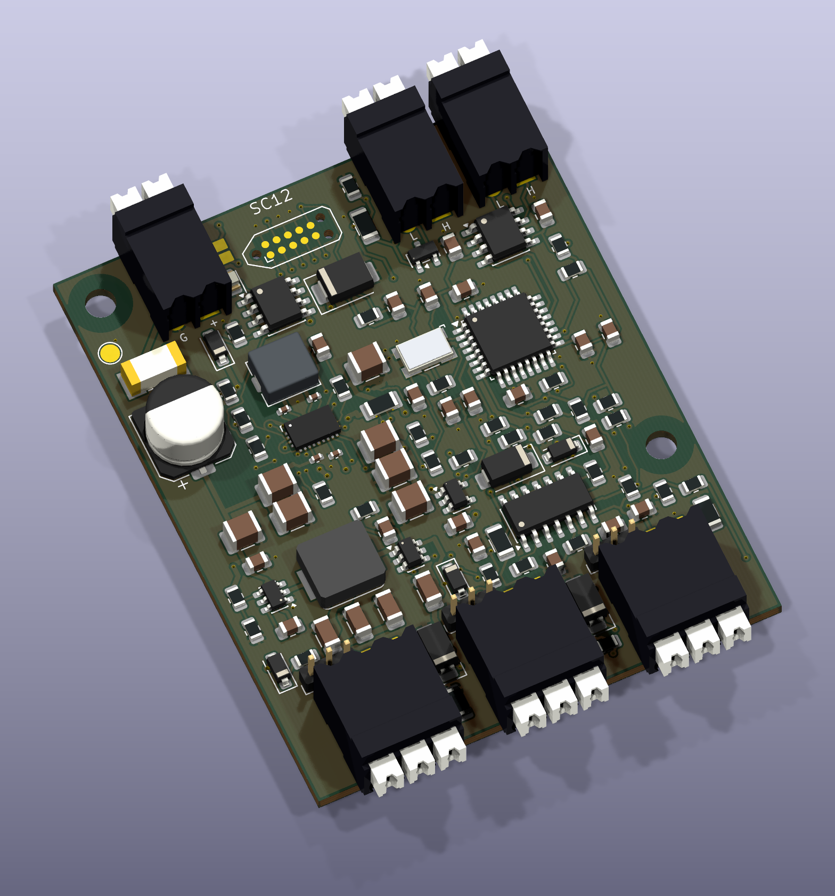
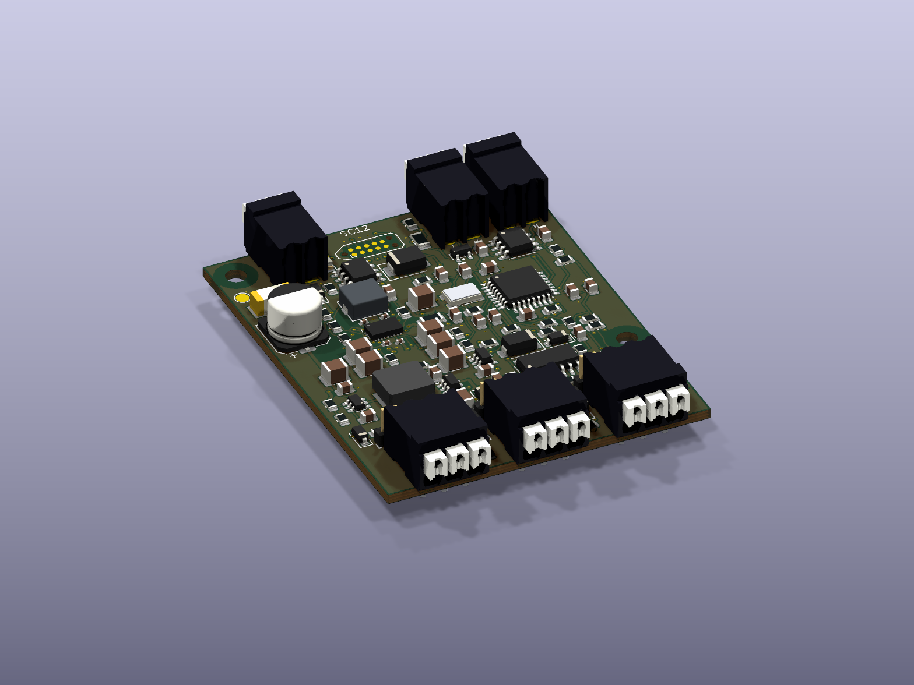

# SC12 — Revision D-2: China SMT assembly and removable voltage jumpers

Rev D-2 preserves Rev D’s circuit and firmware identity (hardware 4, protocol 3). It changes 27 passive placements to specified equivalents, adds three removable power-selection headers, and separates factory SMT assembly from your through-hole work. [Cost basis and remaining costs](docs/COST_REDUCTION.md).

Three industrial digital inputs, selectable **regulated 12 V or 5 V sensor power**, and classic CAN for FRC team projects. The **52 × 64 mm** PCB keeps horizontal Weidmüller push terminals and the compact TC2050 programming contacts. It uses four copper layers, with both inner layers reserved for ground.

**Engineering prototype release.** CAD, source, manufacturing files and checks are provided for review and prototype fabrication. No physical Rev D-2 board has been assembled or qualified. Production release and competition use require the tests in [VALIDATION.md](docs/VALIDATION.md); CAD checks do not establish either.

| Item | Rev D-2 design target |
|---|---|
| Board input | 6–22 V DC at J1, protected distribution branch required |
| Sensor supplies | 12.01 V nominal buck-boost and 5 V nominal; 300 mA shared per rail |
| Inputs | Three PNP, NPN or push-pull inputs; positive signal range 0–30 V |
| Logic thresholds | LOW ≤1.2 V, HIGH ≥2.4 V targets; supports 3.3/5 V logic, not guaranteed 1.8 V |
| Connectors | Weidmüller LSF-SMT 3.50/90; 1824420000 and 1824430000 |
| MCU / CAN | STM32F042K6T6 LQFP32 + TCAN3413 SO8; 1 Mbit/s |
| Power stage | TPS552872-Q1, synchronous buck-boost; 3.3 µH shielded inductor |
| Assembly | 107 fitted parts: 98 top-side factory SMT; six terminals and three headers hand soldered; three loose caps |
| Parts estimate | $40.50 / $34.69 / $32.23 per board in lots of 5 / 10 / 25, including purchase minimums; PCB/assembly/freight/tax extra |
| Firmware | 0.4.0, hardware 4, original protocol v3; Java, C++ and Python interfaces |

12 V remains regulated when the battery is above or below 12 V within the qualified input/load envelope. It is intended for compatible three-wire Omron/Banner sensors; verify the exact model, current, output type and residual/leakage voltage. A brand name alone is not a compatibility guarantee. Sensor power is hardware-enabled; removable 2 mm jumper caps choose each port's supply. No raw battery output is exposed on Rev D-2.

Firmware reports qualified 12 V power-good and 5 V switch fault status. Counts pause on either rail fault and resume only after 100 ms of continuous good indications. Drivers provide a health-checked input helper. These indications are not calibrated voltage measurements and cannot detect every cable or sensor failure.

The integrated switches, current limiting, shared 5 V driver bias and PCB Kelvin taps avoid extra purchased power devices. Most passives remain 0805 or larger. Four local 0402 capacitors and the 21-pad HotRod QFN require a stencil and controlled reflow/heatbed; inspect the power IC joints. Hand soldering the remaining parts is practical. See [design choices](docs/SIMPLIFICATION.md).

| Deliverable | Link |
|---|---|
| Native KiCad PCB / schematic | [PCB](hardware/FRC_Sensor_CAN.kicad_pcb), [schematic](hardware/FRC_Sensor_CAN.kicad_sch) |
| Manufacturing / assembly | [Gerbers and drills](output/fabrication), [interactive BOM](output/assembly/interactive_bom.html), [schematic PDF](output/assembly/schematic.pdf) |
| Ordering | [SMT BOM](bom/Factory_BOM.csv), [JLCPCB CPL](output/assembly/CPL_JLCPCB.csv), [hand-solder BOM](bom/Hand_solder_BOM.csv), [factory instructions](docs/FACTORY_ORDER.md) |
| Prototype factory packet | [ZIP](order/RevD2_SC12_Factory_Upload.zip) |
| Complete source/review release | [ZIP](release/FRC_Sensor_CAN_RevD2_SC12_Prototype.zip), [hashes](release/manifest.json) |
| Mechanical handoff | [STEP](output/mechanical/FRC_Sensor_CAN.step), [dimensioned drawing](output/mechanical/mechanical_drawing.pdf) |
| Setup and operation | [wiring](docs/WIRING.md), [assembly](docs/ASSEMBLY.md), [protocol](docs/CAN_PROTOCOL.md), [drivers](examples/README.md) |
| Engineering checks | [Consolidated report](reports/release_checks.json), [qualification plan](docs/VALIDATION.md) |
| Printable handbook | [PDF](output/documentation/SC12_RevD2_Handbook.pdf) |

[Connector geometry and official model provenance](docs/CONNECTORS.md). Case design is a subsequent task after review of this revision; the mechanical files are a nominal handoff, not an enclosure fit test. Earlier A/B/B-2/C/D designs remain available in the repository.
